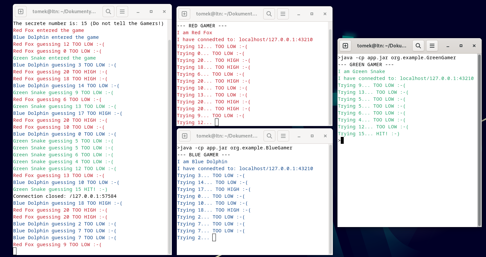
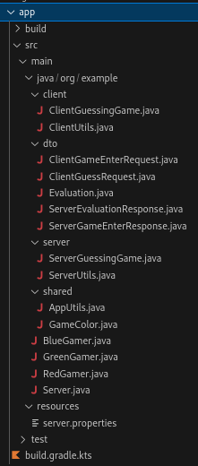
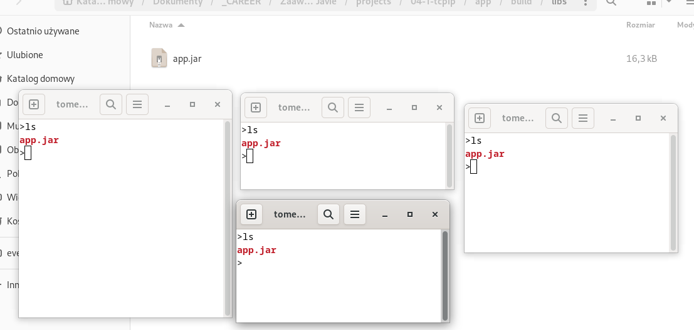
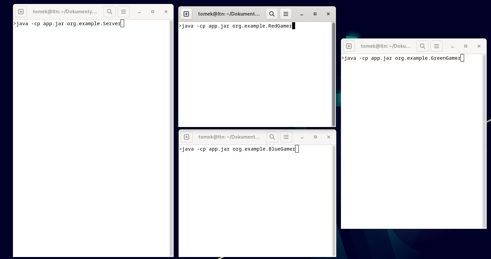
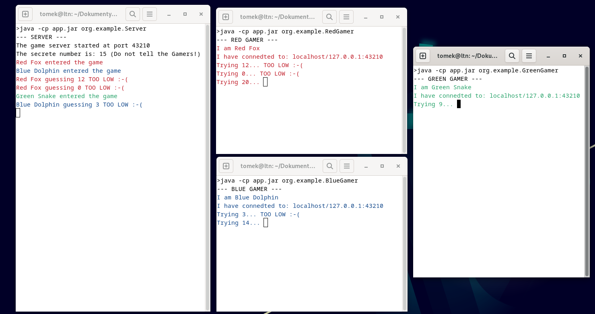
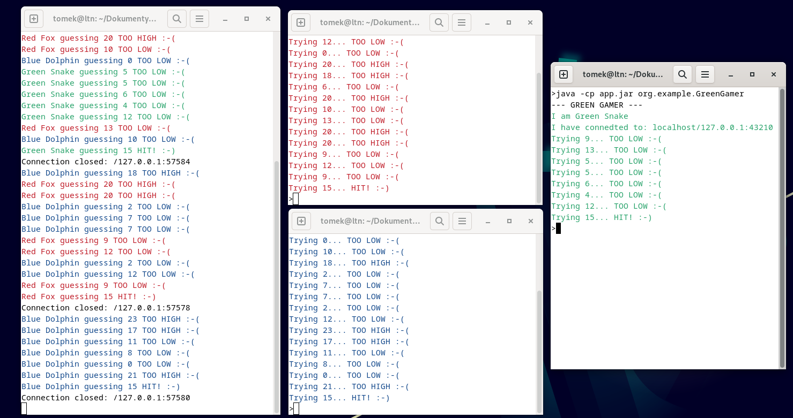

# Zadanie 4.1 — Gra „zgadnij liczbę” (klient–serwer, `java.net`)

Źródło: [slajdy instrukcji](https://nowicki.house/java2/labs-slides/zad-4.1/slides.html) (48 slajdów).  
Obrazki lokalnie: `docs/slides-images/`.

---

## Opis gry (z treści laboratorium)

- Wielu uczestników; **uczestnik główny** = serwer, **pozostali** = klienci.
- Serwer generuje sekretną liczbę `number` z zakresu `0..N` i przekazuje klientom tylko `N` (zakres).
- Klienci wysyłają propozycje; serwer odpowiada jedną z trzech ocen:
  - `HIT` — trafienie (klient kończy grę),
  - `OVERVALUED` — za dużo (`TOO HIGH :-(` w UI),
  - `UNDERVALUED` — za mało (`TOO LOW :-(` w UI).
- Wersja sieciowa: `java.net` (TCP, `ServerSocket` / `Socket`, serializacja obiektów).

---

## Slajd 1 — Start projektu

- Wygeneruj projekt Java.
- Wybierz **Gradle** z **Kotlin** (`build.gradle.kts`).
- Sprawdź, czy jest klasa z `main` (`Main` / `App` …); jeśli nie — utwórz.
- Uruchom i sprawdź, że działa.

> U Ciebie: projekt Gradle + JDK 21, `Main` się odpala — ten krok masz za sobą.

---

## Slajd 2 — Generowanie JAR

Sprawdź w `build.gradle.kts`, czy jest:

```kotlin
plugins {
    application
}
```

- Jeśli tak: `gradle jar` (lub task **jar** w IDE) → `build/libs`.
- Gradle 9 domyślnie nazywa wynikowy plik `app.jar`.

> **Uwaga do Twojego projektu:** obecnie masz tylko `id("java")` — bez `application`. Do generowania `app.jar` jak w instrukcji trzeba dodać plugin `application` (i zwykle `mainClass`).

---

## Slajdy 3–4 — Jak to zostanie zrealizowane

- W **jednym projekcie** jest i serwer, i klient.
- Klasy uruchomieniowe (`main`):
  - 1× serwer (już skonfigurowany),
  - 3× klienci (też skonfigurowani).
- Wszystkie trafiają do jednego **JAR**; z tego samego JAR uruchamiasz albo serwer, albo wybranego klienta.
- Każde uruchomienie = niezależny proces; komunikacja sieciowa.
- Aplikacja uruchamiana **4 razy** na hoście w różny sposób.
- Klient odgaduje przez **losowe** propozycje z przedziału gry, aż do `HIT`.

---

## Slajd 5 — Efekt działania (screen-01.png)



**Opis obrazka:** Cztery terminale na pulpicie Linux.

| Okno | Rola | Co widać |
|------|------|----------|
| Lewy (duży) | Serwer | `The secrete number is: 15`, logi wejść graczy i zgadywań w kolorach, na końcu `Connection closed: /127.0.0.1:...` |
| Środkowy górny | Red Gamer | `I am Red Fox`, połączenie z `localhost/...:43210`, `Trying X... TOO LOW/TOO HIGH` |
| Środkowy dolny | Blue Gamer | `java -cp app.jar org.example.BlueGamer`, `I am Blue Dolphin`, analogiczne zgadywanie |
| Prawy | Green Gamer | `java -cp app.jar org.example.GreenGamer`, `Trying 15... HIT! :-)`, proces wraca do promptu |

Literówki w komunikatach instrukcji (zachować jak w slajdach): `secrete`, `connedted`.

---

## Slajdy 6–7 — Struktura projektu

### Opis obrazka `files-01.png`



Drzewo w IDE (pakiet `org.example`):

```
app/
  build.gradle.kts
  src/main/java/org/example/
    BlueGamer.java
    GreenGamer.java
    RedGamer.java
    Server.java
    client/
      ClientGuessingGame.java
      ClientUtils.java
    dto/
      ClientGameEnterRequest.java
      ClientGuessRequest.java
      Evaluation.java
      ServerEvaluationResponse.java
      ServerGameEnterResponse.java
    server/
      ServerGuessingGame.java
      ServerUtils.java
    shared/
      AppUtils.java
      GameColor.java
  src/main/resources/
    server.properties
  src/test/   (może być pusty)
```

### Pakiety

| Pakiet | Rola |
|--------|------|
| `client` | Klient + kod pomocniczy |
| `server` | Serwer + kod pomocniczy |
| `shared` | Kod wspólny |
| `dto` | Data Transfer Objects — obiekty wymieniane siecią |

Klasy uruchomieniowe (wskazywane przy starcie z JAR): `Server`, `BlueGamer`, `GreenGamer`, `RedGamer`.

**Wykonaj:** utwórz podpakiety jak na ilustracji. Katalog `app` może nie istnieć (zależnie od Gradle); na początku może nie być `build`.

---

## Slajdy 8–9 — Konfiguracja `server.properties`

Utwórz w `src/main/resources` plik **`server.properties`** (w slajdzie tytuł ma literówkę `server.properies`; w kodzie plik to `server.properties`):

```properties
server.port=43210
server.dalayms=5000
```

- `server.port` — port nasłuchu serwera.
- `server.dalayms` — maksymalne opóźnienie odpowiedzi serwera w ms (losowe opóźnienie ≤ tej wartości). Nazwa klucza z literówką `dalay` — tak jest w instrukcji.
- Katalog `resources` trafia do JAR.

---

## Pakiet `shared`

> We wszystkich fragmentach kodu ze slajdów **brak deklaracji `package`** — dodaj własny (np. `package org.example.shared;`).

### `AppUtils.java` — szkielet

```java
import java.io.InputStream;
import java.util.Properties;
import java.io.IOException;

public class AppUtils {

    static final String SERVER_CONFIG_FILE = "server.properties";
    static final String KEY_PORT = "server.port";
    static final String KEY_DELAY = "server.dalayms";

    static Integer getIntegerFromProperties(String key){
        //...
    }

    public static Integer getServerPortNumberFromProperties(){
        //...
    }

    public static Integer getServerDalayFromProperties(){
        //...
    }
}
```

### `getIntegerFromProperties`

```java
static Integer getIntegerFromProperties(String key){

        try(InputStream input = AppUtils.class.getResourceAsStream("/" + SERVER_CONFIG_FILE)){

            if(input == null) return null; //Oznacza, żę nie udało się utworzyć strumienia

            Properties properties = new Properties();
            properties.load(input); //Jeżeli się nie uda, to rzuci IOException

            String value = properties.getProperty(key);
            if(value == null) return null; //Nie ma takiego klucza w properies

            return Integer.parseInt(value); //Ryzyko NumberFormatException

        } catch(IOException ex){ return null; }
        catch(NumberFormatException ex) { return null; }
}
```

### Port i delay

```java
public static Integer getServerPortNumberFromProperties(){

        Integer port = getIntegerFromProperties(KEY_PORT);
        if(port == null || port < 1024 || port > 49151) return null;
        return port;
}

public static Integer getServerDalayFromProperties(){

        Integer delayMs = getIntegerFromProperties(KEY_DELAY);
        if(delayMs == null || delayMs < 0 || delayMs > 5000) return null;
        return delayMs;
}
```

Obie metody zwracają `null`, gdy dane są niepoprawne. Na tym etapie warto je przetestować.

### `GameColor.java`

```java
public enum GameColor {

    RESET_COLOR("\u001B[0m"),

    RED("\u001B[31m"),
    GREEN("\u001B[32m"),
    BLUE("\u001B[34m");

    private final String code;

    GameColor(String code) {
        this.code = code;
    }

    public String getCode() {
        return code;
    }

    @Override
    public String toString() {
        return code;
    }
}
```

Kody ANSI do kolorowania tekstu w terminalu; wstawienie enuma do stringa daje kod koloru aż do `RESET_COLOR`.

---

## Pakiet `dto`

### `ClientGameEnterRequest.java`

Klient wysyła przy wejściu do gry: nick + kolor.

```java
import java.io.Serializable;
import org.example.shared.GameColor;

public class ClientGameEnterRequest implements Serializable{

    private static final long serialVersionUID = 1L;

    public final String nick;
    public final GameColor color;

    public ClientGameEnterRequest(String nick, GameColor color) {

        this.nick = nick;
        this.color = color;
    }
}
```

Obiekty sieciowe: `Serializable` + unikatowy `serialVersionUID`.

### `ServerGameEnterResponse.java`

Odpowiedź z zakresem gry.

```java
import java.io.Serializable;

public class ServerGameEnterResponse implements Serializable{

    private static final long serialVersionUID = 2L;

    final public int from, to;
    final public boolean fromIncluded, toIncluded;

    public ServerGameEnterResponse(int from, boolean fromIncluded, int to, boolean toIncluded){

        if(from >= to) throw new IllegalArgumentException();
        this.from = from;
        this.fromIncluded = fromIncluded;
        this.to = to;
        this.toIncluded = toIncluded;
    }


    public ServerGameEnterResponse(int max) {

        this(0, true, max, true);
    }

}
```

### `ClientGuessRequest.java`

```java
import java.io.Serializable;

public class ClientGuessRequest implements Serializable{

    private static final long serialVersionUID = 10L;

    final public int guess;

    public ClientGuessRequest(int guess) {

        this.guess = guess;
    }
}
```

### `ServerEvaluationResponse.java`

```java
import java.io.Serializable;

public class ServerEvaluationResponse implements Serializable {

    private static final long serialVersionUID = 11L;

    final public int guess;
    final public Evaluation result;

    public ServerEvaluationResponse(int guess, Evaluation evaluation) {
        this.guess = guess;
        this.result = evaluation;
    }
}
```

### `Evaluation.java`

```java
public enum Evaluation {

    HIT("HIT! :-)"),
    OVERVALUED("TOO HIGH :-("),
    UNDERVALUED("TOO LOW :-(");

    private final String message;

    Evaluation(String message) {
        this.message = message;
    }

    @Override
    public String toString() {
        return message;
    }
}
```

---

## Pakiet `server`

### `ServerUtils.java` (w slajdzie nazwa klasy `ServerUtils`, plik bywa nazywany `ServerUtil`)

```java
import java.util.Random;
import org.example.dto.*;

class ServerUtils {

    static int generateSecretNumber(int fromIncluded, int toIncluded){

        Random rand = new Random();
        return rand.nextInt((toIncluded - fromIncluded) + 1) + fromIncluded;
    }

    static ServerEvaluationResponse evaluate(ClientGuessRequest clientGuess, int secretNumber){

        Evaluation evaluation =
            clientGuess.guess > secretNumber ? Evaluation.OVERVALUED :
            clientGuess.guess < secretNumber ? Evaluation.UNDERVALUED :
            Evaluation.HIT;

        return new ServerEvaluationResponse(clientGuess.guess, evaluation);
    }

}
```

### `ServerGuessingGame.java` — importy

```java
import java.net.Socket;
import java.util.concurrent.ThreadLocalRandom;
import java.net.ServerSocket;
import java.io.ObjectInputStream;
import java.io.ObjectOutputStream;
import java.io.EOFException;
import java.io.IOException;

import org.example.dto.*;
import org.example.shared.*;
import static org.example.shared.GameColor.*;
```

### Szkielet

```java
public class ServerGuessingGame {

    private final ServerGameEnterResponse gameRange;
    private final Integer port, delayMs, secretNumber;

    public ServerGuessingGame(ServerGameEnterResponse gameRange){
        //...
    }

    public void start() {
        //...
    }

    private void handleClient(Socket socket) {
        //...
    }
}
```

### Konstruktor

```java
public ServerGuessingGame(ServerGameEnterResponse gameRange){

        this.gameRange = gameRange;

        this.port = AppUtils.getServerPortNumberFromProperties();
        if(this.port == null ) throw new IllegalArgumentException("!Failed to read the server port");

        this.delayMs = AppUtils.getServerDalayFromProperties();
        if(this.delayMs == null) throw new IllegalArgumentException("!Failed to read the server delay");

        this.secretNumber = ServerUtils.generateSecretNumber(
            gameRange.fromIncluded ? gameRange.from : gameRange.from + 1,
            gameRange.toIncluded ? gameRange.to : gameRange.to - 1
        );
    }
```

### `start`

```java
    public void start() {

        try(ServerSocket serverSocket = new ServerSocket(port)) {

            System.out.println("The game server started at port " + port);
            System.out.println("The secrete number is: " + secretNumber + " (Do not tell the Gamers!)");

            while (true) {
                //Akceptacja połączenia z klientem
                Socket socketForClient = serverSocket.accept();
                //i przerzucenie obsługi do odrębnego wątku
                Thread.startVirtualThread(() -> handleClient(socketForClient));
            }

        } catch (IOException e) {
            System.err.println("!Failed to start the game server");
        }

        System.out.println("The game server is colosed");
        //try-with-resource automatyznie zamyka serverSocket
    }
```

> Wirtualne wątki (`Thread.startVirtualThread`) wymagają Java 21+ — u Ciebie OK.

### Szkielet `handleClient`

```java
private void handleClient(Socket socket) {

        GameColor clientColor = RESET_COLOR;
        String clientNick = "";

        try( ObjectInputStream in = new ObjectInputStream(socket.getInputStream());
             ObjectOutputStream out = new ObjectOutputStream(socket.getOutputStream())) {

                while(true){
                    // Tutaj obsługa klienta
                }

        }catch(EOFException ex) {
            System.err.println("Connection closed: " + socket.getRemoteSocketAddress());
        }catch(IOException ex){ //Strumienie
            System.err.println("!Failed to connect to: " + socket.getRemoteSocketAddress());
        } catch(ClassNotFoundException ex){
            System.err.println("!Failed to read data from: " + socket.getRemoteSocketAddress());
        } finally{ try { socket.close(); } catch (IOException ignored) {} }

    }
```

### Ciało `while` w `handleClient`

```java
while(true){
    Object request = in.readObject(); //ClassNotFoundException

    if(request instanceof ClientGameEnterRequest enterRequest) {
        //Jeżeli odebrany obiekt jest klasy ClientGameEnterRequest
        out.writeObject(gameRange); //Wówczas odsyła zasady gry,
        out.flush();                //czyli tutaj zakres liczbowy
        clientColor = enterRequest.color; //Zapisuje też kolor
        clientNick = enterRequest.nick;   //i nazwę klienta

        System.out.println(clientColor + clientNick + " entered the game" + RESET_COLOR);

    } else if(request instanceof ClientGuessRequest guessRequest) {
        //Jeżeli odebrany obiekt jest klasy ClientGuessRequest, to odsyła ewaluację wartości klienta
        //Wprowadza sztuczne opóźnienie o losowej długości
        try { Thread.sleep(ThreadLocalRandom.current().nextInt(delayMs));
        } catch (InterruptedException _ignored) {}
        ServerEvaluationResponse evaluationResponse = ServerUtils.evaluate(guessRequest, secretNumber);
        out.writeObject(evaluationResponse);
        out.flush();

        System.out.println(clientColor + clientNick + " guessing "
             + guessRequest.guess + " " + evaluationResponse.result + RESET_COLOR);

    } else { throw new ClassNotFoundException(); }
 }
```

> W slajdzie przy `println` zgadywania brakowało średnika — powyżej jest poprawione.

### Działanie serwera (podsumowanie)

1. Otwiera `ServerSocket`.
2. Przy połączeniu tworzy `Socket` i deleguje obsługę do wątku.
3. W wątku przyjmuje tylko:
   - `ClientGameEnterRequest` → odsyła `ServerGameEnterResponse` (ten sam zakres dla wszystkich),
   - `ClientGuessRequest` → odsyła `ServerEvaluationResponse`.

---

## Pakiet `client`

### `ClientUtils.java`

```java
import java.util.Random;
import org.example.dto.*;

class ClientUtils {

    static ClientGuessRequest generateRandomGuess(ServerGameEnterResponse gameRange){

        int fromIncluded = gameRange.fromIncluded ? gameRange.from : gameRange.from + 1;
        int toIncluded = gameRange.toIncluded ? gameRange.to : gameRange.to - 1;

        int randomFromGameRange = new Random().nextInt((toIncluded - fromIncluded) + 1) + fromIncluded;

        return new ClientGuessRequest(randomFromGameRange);
    }
}
```

### `ClientGuessingGame.java` — bez ciała `start`

```java
import java.net.Socket;
import java.io.ObjectInputStream;
import java.io.ObjectOutputStream;
import java.io.IOException;
import java.net.UnknownHostException;
import org.example.dto.*;
import static org.example.dto.Evaluation.*;
import org.example.shared.*;

public class ClientGuessingGame {

    private final ClientGameEnterRequest myGameEnterRequest;
    private ServerGameEnterResponse gameRange;

    public ClientGuessingGame(String nick, GameColor color){
        myGameEnterRequest = new ClientGameEnterRequest(nick, color);
    }

    private void  printInColor(String msg) {
        System.out.print(myGameEnterRequest.color
           + msg + GameColor.RESET_COLOR);
    }

    public void start(String serverAddress, int serverPort) {
        // ... Kod na następnym slajdzie
    }
}
```

### Ciało `start`

```java
public void start(String serverAddress, int serverPort) {
        try(
            Socket socket = new Socket(serverAddress, serverPort);
            ObjectOutputStream out = new ObjectOutputStream(socket.getOutputStream());
            ObjectInputStream in = new ObjectInputStream(socket.getInputStream()) ){
                //0. Informacje o połączeniu z serwerem
                printInColor("I am " + myGameEnterRequest.nick +"\n");
                printInColor("I have connedted to: " + socket.getRemoteSocketAddress() + "\n");
                //1. Pobranie zasad gry, tylko raz
                out.writeObject(myGameEnterRequest);
                out.flush();
                gameRange = (ServerGameEnterResponse)in.readObject();
                //2. Udział w grze w pętli
                ClientGuessRequest myGuess = ClientUtils.generateRandomGuess(gameRange);
                while (true) {
                    printInColor("Trying " + myGuess.guess + "... ");
                    out.writeObject(myGuess);
                    out.flush();
                    ServerEvaluationResponse serverEvaluation = (ServerEvaluationResponse) in.readObject();
                    printInColor(serverEvaluation.result + "\n");
                    if(serverEvaluation.result == HIT) break;
                    myGuess = ClientUtils.generateRandomGuess(gameRange);
                }
        }catch(UnknownHostException ex){ printInColor("!Failed to connect to: " + serverAddress + "\n");
        }catch(IOException ex){ printInColor("!Failed to connect or transfer data to: " + serverAddress + "\n");
        }catch(ClassNotFoundException ex){ printInColor("Failed to communicate with: " + serverAddress + "\n");}
    }
```

### Działanie klienta

1. Łączy się z serwerem.
2. Raz wysyła `ClientGameEnterRequest`.
3. Raz odbiera `ServerGameEnterResponse`.
4. W pętli: `ClientGuessRequest` → `ServerEvaluationResponse`; przy `HIT` wyjście z pętli.

---

## Klasy uruchomieniowe (`org.example`)

### `Server.java`

```java
import org.example.dto.ServerGameEnterResponse;
import org.example.server.ServerGuessingGame;

public class Server {

    final static int N = 25; //Zakres liczb będzie od 0 do 25

    public static void main(String[] args) {

        System.out.println("--- SERVER ---");
        ServerGameEnterResponse gameRange = new ServerGameEnterResponse(N);
        new ServerGuessingGame(gameRange).start();
    }
}
```

### `BlueGamer.java`

```java
import org.example.shared.AppUtils;
import static org.example.shared.GameColor.BLUE;;

public class BlueGamer {

    final static String HOST = "localhost";
    final static Integer PORT = AppUtils.getServerPortNumberFromProperties();

    public static void main(String[] args) {

        System.out.println("--- BLUE GAMER ---");
        new ClientGuessingGame("Blue Dolphin", BLUE).start(HOST, PORT);
    }
}
```

> W slajdzie brak importu `ClientGuessingGame` — dodać `import org.example.client.ClientGuessingGame;`.

### `GreenGamer.java`

```java
import org.example.client.ClientGuessingGame;
import org.example.shared.AppUtils;
import static org.example.shared.GameColor.GREEN;;

public class GreenGamer {

    final static String HOST = "localhost";
    final static Integer PORT = AppUtils.getServerPortNumberFromProperties();

    public static void main(String[] args) {

        System.out.println("--- GREEN GAMER ---");
        new ClientGuessingGame("Green Snake", GREEN).start(HOST, PORT);
    }
}
```

### `RedGamer.java`

```java
import org.example.client.ClientGuessingGame;
import org.example.shared.AppUtils;
import static org.example.shared.GameColor.RED;;

public class RedGamer {

    final static String HOST = "localhost";
    final static Integer PORT = AppUtils.getServerPortNumberFromProperties();

    public static void main(String[] args) {

        System.out.println("--- RED GAMER ---");
        new ClientGuessingGame("Red Fox", RED).start(HOST, PORT);
    }
}
```

---

## Uruchomienie

### Przygotowanie terminali (`screen-02.png`)



**Opis:** Katalog `.../build/libs` z plikiem `app.jar` (~16 kB). Cztery terminale z `cwd` ustawionym na ten katalog (`ls` pokazuje `app.jar`).

### Polecenia (`screen-03.png`)



```bash
java -cp app.jar org.example.Server
java -cp app.jar org.example.RedGamer
java -cp app.jar org.example.GreenGamer
java -cp app.jar org.example.BlueGamer
```

- Serwer kończysz `Ctrl+C`.
- Klienci kończą się sami po `HIT`.

### Praca systemu w trakcie (`screen-04.png`)



**Opis:** Serwer na porcie 43210, sekret = 15. Kolorowe logi: wejścia Red Fox / Blue Dolphin / Green Snake oraz zgadywania `TOO LOW`. Klienci piszą w swoich kolorach (`Trying …`).

### Po HIT / rozłączeniach (`screen-01.png`, `screen-05.png`)



**Opis:** Gracz trafia (`HIT! :-)`), serwer loguje `Connection closed: /127.0.0.1:...`. Proces klienta wraca do promptu; serwer dalej działa — można uruchomić klienta ponownie. Zakończenie serwera: `Ctrl+C` w jego terminalu.

---

## Checklist realizacji (kolejność sensowna)

1. [ ] Dodać plugin `application` do `build.gradle.kts` (pod JAR).
2. [ ] Utworzyć pakiety: `client`, `server`, `shared`, `dto`.
3. [ ] `resources/server.properties`.
4. [ ] `shared`: `AppUtils`, `GameColor` (+ szybki test odczytu properties).
5. [ ] `dto`: wszystkie 5 klas + `Evaluation`.
6. [ ] `server`: `ServerUtils`, `ServerGuessingGame`.
7. [ ] `client`: `ClientUtils`, `ClientGuessingGame`.
8. [ ] Klasy `main`: `Server`, `RedGamer`, `GreenGamer`, `BlueGamer`.
9. [ ] `./gradlew jar` → uruchomienie 4 procesów jak wyżej.

---

## Uwagi / literówki ze slajdów (świadomie)

| W slajdzie | Znaczenie |
|------------|-----------|
| `server.properies` (tytuł) | plik = `server.properties` |
| `server.dalayms` | klucz properties (delay) |
| `secrete`, `connedted`, `colosed` | teksty w `println` jak w instrukcji |
| `;;` przy importach kolorów | wystarczy jeden `;` |
| brak `package` w kodach | dodać samemu |

---

🏁 Koniec instrukcji ze slajdów 1–48.
